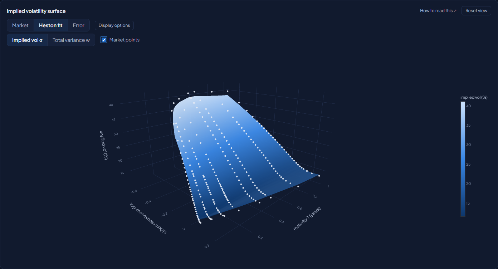
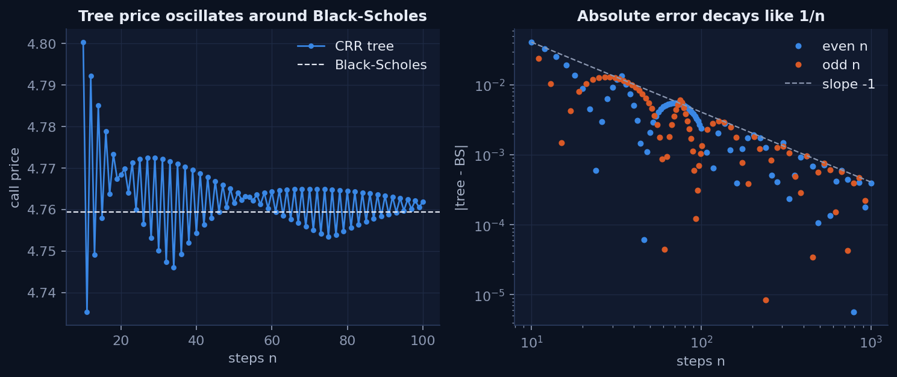
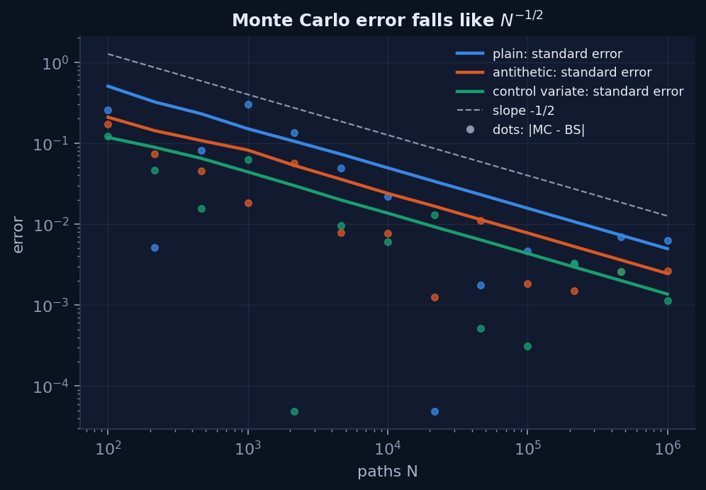
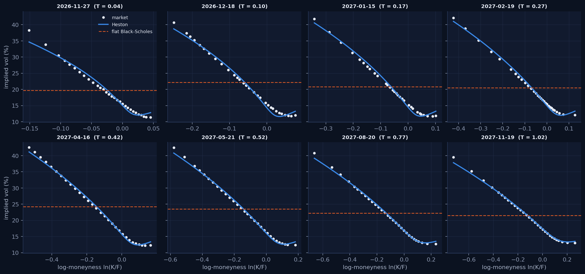
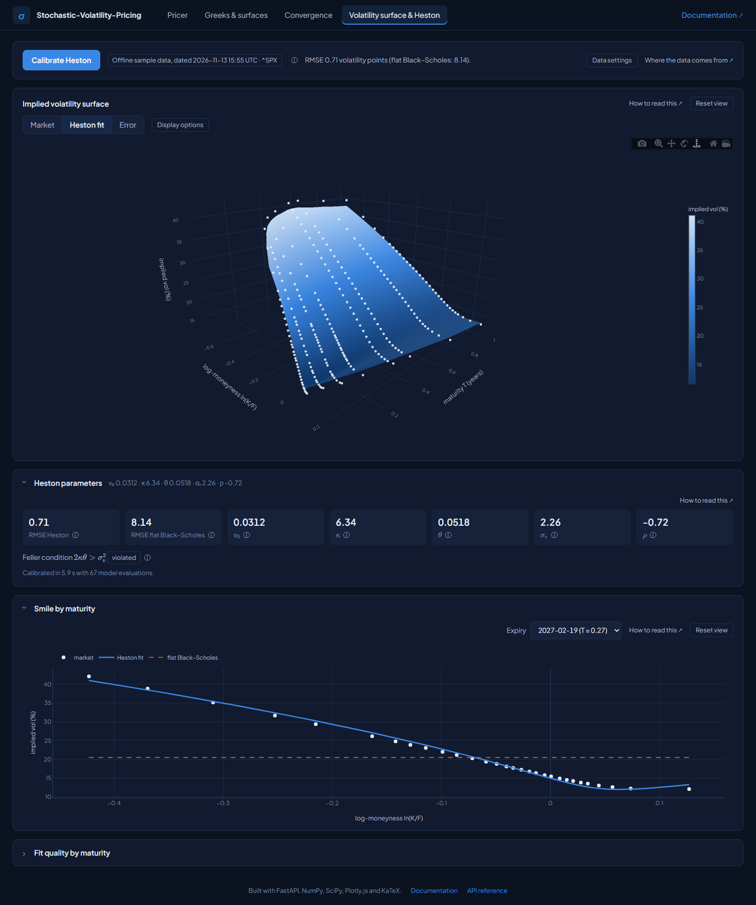

# Stochastic-Volatility-Pricing

A constant-volatility model cannot reproduce the prices at which index options actually trade. This project measures that gap and closes most of it. Part 1 is a small option-pricing library (Black–Scholes–Merton, a Cox–Ross–Rubinstein binomial tree, Monte Carlo with variance reduction, Greeks computed two ways, implied volatility) with a convergence study against the closed-form price. Part 2 calibrates the Heston stochastic-volatility model, priced through its characteristic function, to real S&P 500 option quotes across eight maturities at once. Headline results: on Hull's textbook example the tree error decays like 1/n and the Monte Carlo error like N^(-1/2), with a control variate cutting the variance 13 times; on 240 S&P 500 quotes from two weeks to one year, Heston fits implied volatilities with an RMSE of **0.71 volatility points against 8.14** for the best flat Black–Scholes volatility per maturity, in about two seconds. Everything is exposed through a FastAPI backend and a hand-written HTML/CSS/JavaScript front end with rotatable 3D surfaces, plus a documentation site that explains every formula and every number on screen.



*The fitted Heston surface in the app (rotatable). White points are market quotes; the sample is dated 2026-11-13.*

## Results

**Pricing library**, Hull's example (S₀ = 42, K = 40, r = 10%, σ = 20%, T = 0.5, call):

| Method | Price | Error against Black–Scholes |
|---|---|---|
| Black–Scholes–Merton | 4.7594 | exact |
| Binomial tree, n = 1000 | 4.7598 | 3.9e-4 |
| Monte Carlo, N = 100,000, control variate | 4.7637 ± 0.0085 | inside the 95% interval |

**Monte Carlo variance reduction** at N = 1,000,000 paths:

| Estimator | Standard error | Variance reduction | Efficiency gain (variance × time) |
|---|---|---|---|
| Plain | 0.0050 | 1.0× | 1.0× |
| Antithetic variates | 0.0025 | 4.1× | about 5–6× |
| Control variate (S_T) | 0.0014 | 13.2× | about 8–9× |

The efficiency column depends on the machine; the standard errors are reproducible (fixed seed).




**Heston calibration** to S&P 500 (`^SPX`) options, snapshot of 2026-11-13 15:55 UTC, 240 out-of-the-money quotes, 8 expiries:

| Parameter | v₀ | κ | θ | σ_v | ρ |
|---|---|---|---|---|---|
| Fitted value | 0.0312 | 6.34 | 0.0518 | 2.26 | −0.72 |

| Expiry | T (years) | RMSE flat Black–Scholes | RMSE Heston |
|---|---|---|---|
| 2026-11-27 | 0.04 | 7.01 | 1.07 |
| 2026-12-18 | 0.10 | 8.80 | 0.92 |
| 2027-01-15 | 0.17 | 8.05 | 0.83 |
| 2027-02-19 | 0.27 | 7.86 | 0.66 |
| 2027-04-16 | 0.42 | 9.70 | 0.58 |
| 2027-05-21 | 0.52 | 8.83 | 0.52 |
| 2027-08-20 | 0.77 | 7.55 | 0.41 |
| 2027-11-19 | 1.02 | 6.95 | 0.41 |
| **All** | | **8.14** | **0.71** |

RMSE is in volatility points (1 point = 0.01 of implied volatility). The flat benchmark gets one free volatility per maturity (8 numbers); Heston uses 5 parameters for the whole surface. The Feller condition is violated (2κθ = 0.66 < σ_v² = 5.09), which is usual for index calibrations. Four different starting points converge to the same parameters.





## How to run

Python 3.11 or newer.

```bash
pip install -r requirements.txt
python -m uvicorn api.main:app --reload
```

Then open <http://localhost:8000>. The documentation is at <http://localhost:8000/docs-site/> and the interactive API reference at <http://localhost:8000/docs>.

`python -m uvicorn` makes sure the server runs with the same Python that `pip` installed into. If `uvicorn` is on your PATH for that Python, `uvicorn api.main:app --reload` is equivalent.

| Command | What it does |
|---|---|
| `python -m pytest` | Runs the 69 tests (about 10 seconds) |
| `python -m pricing.convergence` | Regenerates the convergence figures in `figures/` |
| `python -m pricing.calibration` | Calibrates Heston to the sample and regenerates the smile figures |
| `python -m data.fetch_options` | Downloads a fresh option chain into `data/cache/` |
| `python -m data.fetch_options --save-sample` | Also replaces the committed sample (run during US market hours) |
| `python -m docs.make_illustrations` | Regenerates the images of the documentation |

The app never needs the network for data: if a live download fails, or the US market is closed and Yahoo returns no quotes, it falls back to `data/sample_chain.csv` and shows an "Offline sample data, dated …" badge. Charts and formulas load Plotly.js and KaTeX from a CDN.

## What is in the app

Each tab opens with its main result only. The rest sits in closed sections that open on click, and an ⓘ next to a number explains it on hover.

1. **Pricer**: the three prices side by side. Sections: Monte Carlo confidence intervals for the three estimators, a Greeks table (analytic against finite difference, on the formula, the tree or Monte Carlo) with a one-line reading of each Greek, and an implied-volatility solver.
2. **Greeks & surfaces**: price or one Greek against spot for four maturities, or all six at once. Section: 3D surfaces of price, delta, gamma and vega over spot and maturity.
3. **Convergence**: tree price or error against the number of steps. Sections: Monte Carlo error against the number of paths with the slope −½ reference, and the variance-reduction table.
4. **Volatility surface & Heston**: calibrate and compare market, Heston and error surfaces in 3D (implied volatility or total variance). Sections: the fitted parameters explained, the smile of each expiry, and the fit quality by maturity. "Data settings" switches between live and sample data.

Every chart has a "How to read this" link to the matching section of the documentation.

## Repository layout

```
pricing/     black_scholes, binomial, monte_carlo, greeks, implied_vol, convergence, heston, calibration
data/        fetch_options.py (download, clean, cache) and sample_chain.csv (offline snapshot)
api/         main.py (FastAPI endpoints, static files) and schemas.py (request validation)
web/         index.html, css/style.css, js/ (app, api, ui, pricer, greeks, convergence, surface)
docs/        index.html (documentation site), style.css, make_illustrations.py, img/
tests/       pytest suite
figures/     PNGs for this README and the shared matplotlib style
```

[LEARNING_GUIDE.md](LEARNING_GUIDE.md) gives the order in which to read the code and three exercises to extend it.

## Method in brief

- **Black–Scholes–Merton** closed form with analytic Greeks, vectorised over arrays.
- **CRR tree** with backward induction, European or American.
- **Monte Carlo** with exact simulation of the terminal price; plain, antithetic and control-variate estimators, each with a standard error and a 95% interval.
- **Greeks** by central finite differences for any pricer, with common random numbers for Monte Carlo.
- **Implied volatility** by Brent's method after checking the no-arbitrage bounds; a vectorised bisection for arrays.
- **Heston** priced with the "little Heston trap" characteristic function (Albrecher et al., 2007) and Gil-Pelaez integrals; the integration limit adapts to the decay of the characteristic function. A full-truncation Euler Monte Carlo checks the formula.
- **Market data**: mid prices, liquidity filters, out-of-the-money options only, and a forward per expiry from put–call parity, so no dividend yield has to be guessed.
- **Calibration**: bounded least squares on implied-volatility errors, all maturities jointly.

## Limitations

- **Models.** Black–Scholes assumes constant volatility; Heston has no jumps, so it cannot make the shortest smiles steep enough without a very large volatility of variance (2.26 here), and it curves upwards for high strikes where the market does not. The Feller condition is violated.
- **Calibration.** One snapshot, fitted in sample, equal weights. The optimiser is local; it was checked from four starting points on the sample only. κ and σ_v partly offset each other, so they are not sharply identified. Nothing here tests parameter stability over time or hedging performance.
- **Data.** Yahoo Finance quotes are delayed about 15 minutes and are mids, not tradable prices. One flat interest rate (5% by default, consistent with the rate implied by put–call parity in the sample). Time to expiry is calendar time to 16:00 New York; monthly SPX options settle that morning. Wings with |delta| below 0.02 are dropped and each expiry is thinned to 30 strikes.
- **Numerics.** The tree converges with oscillations and no extrapolation is applied. Monte Carlo uses pseudo-random numbers and handles European payoffs only; American exercise is available in the tree only. The Heston Monte Carlo check has a discretisation bias. The market surface in the app is a linear interpolation of quotes and is not guaranteed free of arbitrage.
- **Scope.** No exotic options, FFT pricing, local volatility or deployment.

## References

Hull, *Options, Futures, and Other Derivatives*; Heston (1993); Albrecher, Mayer, Schoutens and Tistaert (2007); Gatheral, *The Volatility Surface* (2006); Glasserman, *Monte Carlo Methods in Financial Engineering* (2004). Full citations are in the documentation.

---

*Built with AI coding assistance; methodology, tests and analysis reviewed and understood by the author.*
