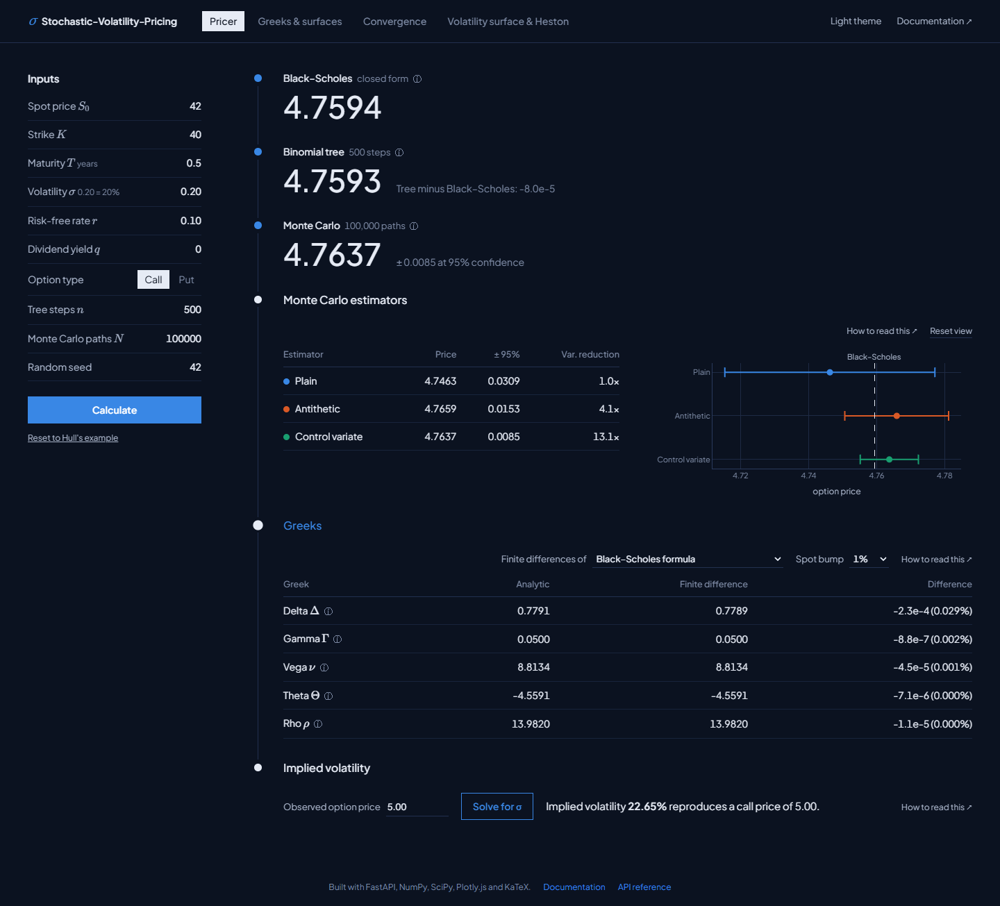
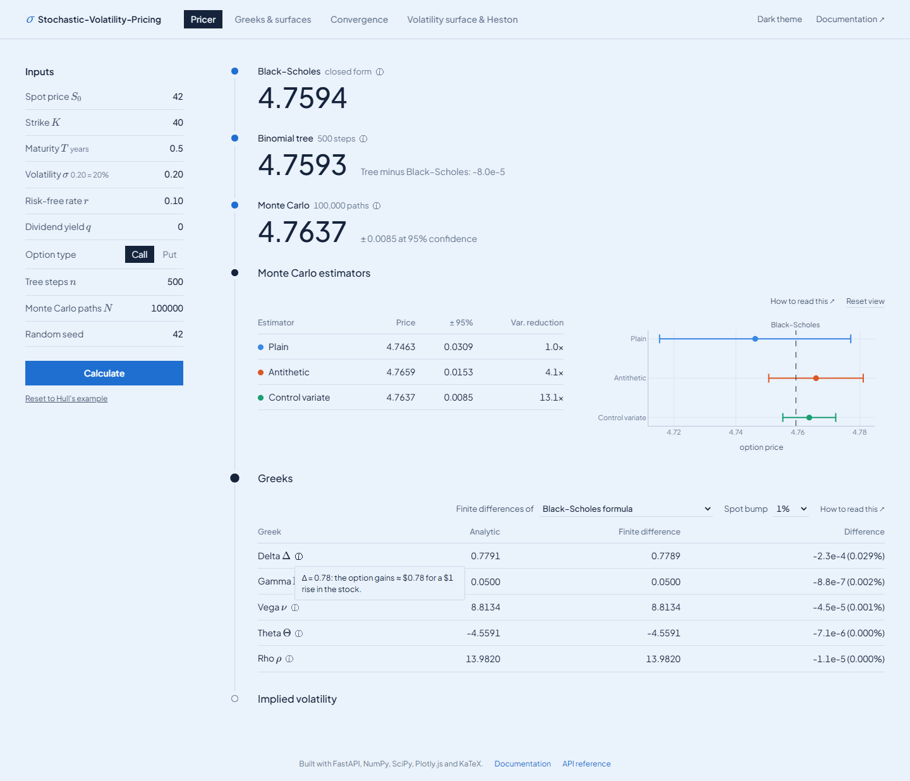

# Stochastic-Volatility-Pricing

A constant-volatility model cannot reproduce the prices at which index options trade. This project measures that gap and closes most of it. Part 1 is an option-pricing library (Black–Scholes–Merton, a CRR binomial tree, Monte Carlo with variance reduction, Greeks two ways, implied volatility) with a convergence study. Part 2 calibrates the Heston model, priced through its characteristic function, to S&P 500 option quotes across eight maturities at once. A FastAPI backend and a hand-written HTML/CSS/JavaScript front end show everything, with a documentation site that explains every formula and number.


*The fitted Heston surface in the app (rotatable). Points are market quotes from 2026-11-13.*

## Results

Hull's example (S₀ = 42, K = 40, r = 10%, σ = 20%, T = 0.5, call):

| Method | Price | Error against Black–Scholes |
|---|---|---|
| Black–Scholes–Merton | 4.7594 | exact |
| Binomial tree, n = 1000 | 4.7598 | 3.9e-4 |
| Monte Carlo, N = 100,000, control variate | 4.7637 ± 0.0085 | inside the 95% interval |

The tree error decays like 1/n and the Monte Carlo error like N^(-1/2). At one million paths, antithetic variates cut the variance 4.1 times and the control variate 13.2 times.

Heston calibrated to 240 out-of-the-money S&P 500 quotes, 8 expiries from two weeks to one year:

| | v₀ | κ | θ | σ_v | ρ | RMSE Heston | RMSE flat Black–Scholes |
|---|---|---|---|---|---|---|---|
| Fitted | 0.0312 | 6.34 | 0.0518 | 2.26 | −0.72 | **0.71** | **8.14** |

RMSE is in volatility points (1 point = 0.01 of implied volatility). The flat benchmark gets one free volatility per maturity; Heston uses five parameters for the whole surface. Its error falls from 1.07 at two weeks to 0.41 at one year, and the calibration takes about two seconds.


## How to run

Python 3.11 or newer.

```bash
pip install -r requirements.txt
python -m uvicorn api.main:app --reload
```

Open <http://localhost:8000>. The documentation is at `/docs-site/` and the API reference at `/docs`.

| Command | What it does |
|---|---|
| `python -m pytest` | Runs the 69 tests |
| `python -m pricing.convergence` | Regenerates the convergence figures |
| `python -m pricing.calibration` | Calibrates Heston to the sample and regenerates the smile figures |
| `python -m data.fetch_options` | Downloads a fresh option chain |

If a live download fails or the US market is closed, the app falls back to `data/sample_chain.csv` and says so.

## The app

| Dark theme | Light theme |
|---|---|
|  |  |

- **Pricer**: the three prices, then Monte Carlo intervals, the Greeks table and an implied-volatility solver.
- **Greeks & surfaces**: price or any Greek against spot, and 3D surfaces over spot and maturity.
- **Convergence**: tree and Monte Carlo errors against steps and paths, and the variance-reduction table.
- **Volatility surface & Heston**: market, Heston and error surfaces in 3D, fitted parameters, smiles and fit quality.

The results of a tab hang from one vertical line, in the order they are computed. Each tab opens with its main result; a hollow point is a closed section that opens on click, and an ⓘ explains a number on hover. The button at the top right switches between the dark and the light blue theme and the choice is remembered. Short animations (sections sliding in, prices counting to their new value) are switched off when the system asks for reduced motion.

## Repository layout

```
pricing/   black_scholes, binomial, monte_carlo, greeks, implied_vol, convergence, heston, calibration
data/      fetch_options.py and sample_chain.csv (offline snapshot)
api/       FastAPI endpoints and request validation
web/       index.html, css/ (style, theme, motion), js/
docs/      documentation site
tests/     pytest suite
figures/   images for this README
```

[LEARNING_GUIDE.md](LEARNING_GUIDE.md) gives a reading order for the code and three exercises to extend it.

## Limitations

- **Models.** Heston has no jumps, so the shortest smiles are not steep enough and the Feller condition is violated (2κθ = 0.66 < σ_v² = 5.09).
- **Calibration.** One snapshot, fitted in sample with a local optimiser (checked from four starting points). κ and σ_v partly offset each other.
- **Data.** Yahoo Finance mid quotes, delayed about 15 minutes, with one flat interest rate.
- **Numerics.** Monte Carlo prices European payoffs only; American exercise is available in the tree only.

## References

Hull, *Options, Futures, and Other Derivatives*; Heston (1993); Albrecher et al. (2007); Gatheral, *The Volatility Surface* (2006); Glasserman, *Monte Carlo Methods in Financial Engineering* (2004). Full citations are in the documentation.

---

*Built with AI coding assistance; methodology, tests and analysis reviewed and understood by the author.*
